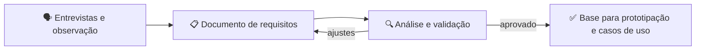

# 📋 Aula — Tema 01 - Levantamento de Requisitos

Antes de prototipar telas e modelar o sistema, a disciplina inicia com o **levantamento de requisitos**: entender o problema, identificar as necessidades dos usuários e documentar o que o sistema deve fazer.

> **Disciplina:** Engenharia de Software II  
> **Tema:** Levantamento e documentação de requisitos (banco e odontologia)

---

## 🎯 Objetivos da aula

- 📋 Entender o que é engenharia de requisitos;
- 🔍 Identificar requisitos funcionais, não funcionais e regras de negócio;
- 📝 Documentar os requisitos de forma clara e rastreável;
- 🗣️ Validar os requisitos com o cliente e registrar ajustes;
- 🧭 Preparar a base para a prototipação e os casos de uso.

---

## 🗺️ Mapa mental da aula

```text
                       📋 Levantamento de Requisitos
                             │
         ┌──────────────┬────┴─────────┬──────────────┐
         │              │              │              │
    👥 Usuários   📄 Requisitos   📏 Regras      ✅ Validação
         │              │              │              │
    Atores        Funcionais,      Negócio       Revisão,
    Necessidades  não funcionais   Restrições    aprovação
```

---

## 🔄 Do problema ao documento de requisitos



| Etapa | Pergunta que responde |
|---|---|
| **Requisitos** | O que o sistema precisa fazer? |
| **Regras de negócio** | Quais restrições e políticas devem ser respeitadas? |
| **Validação** | O cliente concorda com o que foi documentado? |

---

## 📂 Materiais disponíveis

| Arquivo | O que apresenta |
|---|---|
| [📕 atividade01-docRequisitosBanco.pdf](atividade01-docRequisitosBanco.pdf) | Documento de requisitos do sistema bancário. |
| [📕 atividade02-docRequisitosOdonto.pdf](atividade02-docRequisitosOdonto.pdf) | Documento de requisitos do sistema odontológico. |

---

## 📝 Atividade da aula

Elaborar o **documento de requisitos** do sistema escolhido, listando os requisitos funcionais, não funcionais e as regras de negócio, e apresentar para validação com o cliente.

---

## 📚 Referências

- GUEDES, G. T. A. *UML 2: Uma Abordagem Prática*. Novatec.
- LARMAN, C. *Utilizando UML e Padrões*. Bookman.
- PAULA FILHO, W. P. *Engenharia de Software: Fundamentos, Métodos e Padrões*. LTC.

---

[📚 Índice da disciplina](../README.md) · [→ Aula — Tema 02 - Prototipação](../Aula%20%E2%80%94%20Tema%2002%20-%20Prototipa%C3%A7%C3%A3o/README.md)