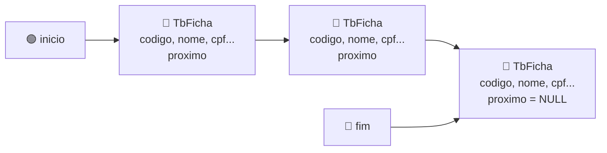

# 🔗 Aula 10 — Lista Dinâmica

A aula apresenta a **alocação dinâmica de memória** com `new` e `delete` e a montagem de estruturas encadeadas. A atividade implementa uma **fila dinâmica** de fichas de clientes: cada registro é criado no momento do cadastro e liberado quando sai da fila, sem o limite de tamanho fixo dos vetores.

> **Disciplina:** Estrutura de Dados  
> **Tema:** Alocação dinâmica, ponteiros e estruturas encadeadas (fila)

---

## 🎯 Objetivos da aula

- 💾 Alocar e liberar memória com `new` e `delete`;
- 🔗 Encadear registros com um ponteiro para o próximo elemento;
- 🎯 Controlar o início e o fim da estrutura com ponteiros;
- 📋 Implementar inserção, exibição e remoção em funções separadas.

---

## 🗺️ Mapa mental da aula

```text
                    🔗 Lista Dinâmica
                           │
         ┌────────────┬────┴─────────┬────────────┐
         │            │              │            │
    💾 Memória   🔗 Encadeamento  🎯 Ponteiros  📋 Operações
         │            │              │            │
    new          struct com       inicio       Inserir
    delete       proximo          fim          Exibir
    Heap         NULL             Acesso       Remover
```

---

## 🔗 Estrutura da fila dinâmica



| Elemento | Papel |
|---|---|
| `TbFicha *inicio` | Aponta para o primeiro cliente, o próximo a ser atendido |
| `TbFicha *fim` | Aponta para o último cliente, onde novos registros entram |
| `proximo` | Ponteiro para o próximo registro; `NULL` no último |
| `new TbFicha` | Aloca um registro na memória dinâmica |
| `delete` | Libera o registro removido da fila |

---

## 🔄 Operações da fila

| Função | O que faz |
|---|---|
| `insereCliente()` | Aloca um novo registro com `new` e o adiciona no **final** da fila |
| `exibeCliente()` | Percorre a fila do `inicio` até `NULL` exibindo os dados |
| `removerPrimeiroDaFila()` | Remove o **primeiro** registro, move `inicio` e libera a memória com `delete` |

---

## 📂 Materiais disponíveis

| Arquivo | O que apresenta |
|---|---|
| [💻 atividadeFila.cpp](atividadeFila.cpp) | Fila dinâmica de clientes com `struct TbFicha`, inserção no final, exibição e remoção do primeiro registro. |

---

## 📝 Atividade da aula

Implementar uma fila dinâmica de fichas de clientes, usando `new` para cada cadastro e `delete` na remoção do primeiro registro. O menu deve permitir **inserir**, **exibir** e **apagar o primeiro registro**, mostrando a fila após cada operação.

---

## 📚 Referências

- DEITEL, H. M.; DEITEL, P. J. *C++: Como Programar*. 6. ed. Pearson, 2011.
- [C++ Reference — new expression](https://en.cppreference.com/w/cpp/language/new)

---

[← Aula 09](../Aula%2009%20%E2%80%94%20Structs/README.md) · [📚 Índice da disciplina](../README.md)
