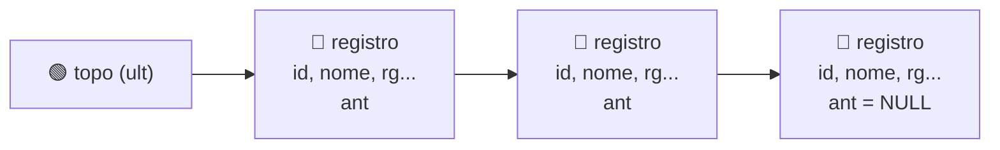

# 📚 Aula 11 — Pilha (Stack)

A aula apresenta a estrutura de dados **pilha (stack)** e seu funcionamento **LIFO** (*Last In, First Out*): o último elemento inserido é o primeiro a ser removido. A atividade implementa uma **pilha dinâmica** de fichas de clientes, onde cada registro é alocado com `new` e empilhado no topo, além de comparar o comportamento da pilha com o de uma fila (**FIFO**).

> **Disciplina:** Estrutura de Dados  
> **Tema:** Pilha (Stack), alocação dinâmica, ponteiros e comparação LIFO × FIFO

---

## 🎯 Objetivos da aula

- 📚 Compreender o conceito de pilha e o princípio LIFO;
- 💾 Alocar e liberar memória com `new` e `delete`;
- 🔗 Encadear registros com um ponteiro para o elemento anterior;
- 🎯 Controlar o topo da estrutura com um ponteiro;
- 📋 Implementar empilhamento (push) e exibição (pop implícito) em funções separadas;
- ⚖️ Comparar o comportamento de uma pilha (LIFO) com o de uma fila (FIFO).

---

## 🗺️ Mapa mental da aula

```text
                     📚 Pilha (Stack)
                            │
          ┌────────────┬────┴─────┬────────────┐
          │            │          │            │
     💾 Memória   🔗 Encadeamento  🎯 Topo   📋 Operações
          │            │          │            │
     new          struct com     ult        Empilhar
     delete       ant           Acesso     Exibir
     Heap         NULL                       (LIFO)
```

---

## 📚 Estrutura da pilha dinâmica



| Elemento | Papel |
|---|---|
| `registro *ult` (topo) | Aponta para o último cliente cadastrado, o primeiro a ser exibido |
| `ant` | Ponteiro para o registro anterior; `NULL` no primeiro elemento (base) |
| `new registro` | Aloca um registro na memória dinâmica |
| `delete` | Libera o registro removido da pilha |

---

## 🔄 Operações da pilha

| Função | O que faz |
|---|---|
| Empilhar (push) | Aloca um novo registro com `new` e o coloca no **topo** da pilha (`aux->ant = ult`) |
| `exibe()` / `exibePilha()` | Percorre a pilha do **topo** até `NULL`, exibindo os dados (ordem LIFO) |
| `exibeFila()` | Percorre a fila do **início** até `NULL`, exibindo os dados (ordem FIFO) |

---

## ⚖️ Pilha (LIFO) × Fila (FIFO)

| Característica | Pilha (Stack) | Fila (Queue) |
|---|---|---|
| Princípio | LIFO — último a entrar, primeiro a sair | FIFO — primeiro a entrar, primeiro a sair |
| Inserção | No topo (`ult`) | No fim (`fim`) |
| Remoção | Do topo (`ult`) | Do início (`inicio`) |
| Uso típico | Desfazer/refazer, chamadas de função, avaliação de expressões | Atendimento, buffers, processamento em ordem |

---

## 📂 Materiais disponíveis

| Arquivo | O que apresenta |
|---|---|
| [💻 atividade01-PilhaDinamica.cpp](atividade01-PilhaDinamica.cpp) | Pilha dinâmica de clientes com `struct registro`, empilhamento no topo e exibição em ordem LIFO. |
| [💻 atividade02-PilhaVsFila.cpp](atividade02-PilhaVsFila.cpp) | Comparação entre Pilha (LIFO) e Fila (FIFO): cadastra e exibe as duas estruturas lado a lado. |

---

## 📝 Atividade da aula

Implementar uma pilha dinâmica de fichas de clientes, usando `new` para cada cadastro e empilhando no topo. O programa deve permitir cadastrar vários clientes e exibir a pilha em ordem LIFO. Na segunda atividade, comparar a exibição da pilha (LIFO) com a de uma fila (FIFO), evidenciando a diferença entre as duas estruturas.

---

## 📚 Referências

- DEITEL, H. M.; DEITEL, P. J. *C++: Como Programar*. 6. ed. Pearson, 2011.
- [C++ Reference — new expression](https://en.cppreference.com/w/cpp/language/new)
- [C++ Reference — Stack (container adapter)](https://en.cppreference.com/w/cpp/container/stack)

---

[← Aula 10](../Aula%2010%20%E2%80%94%20Lista%20Din%C3%A2mica/README.md) · [📚 Índice da disciplina](../README.md)