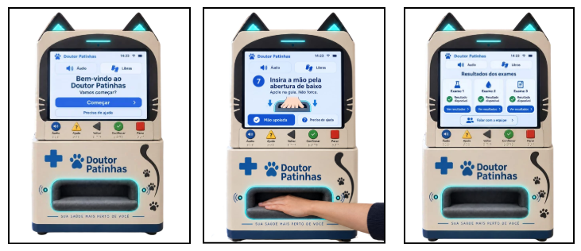
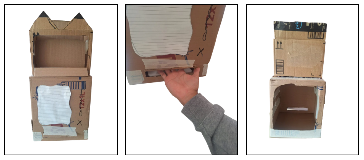
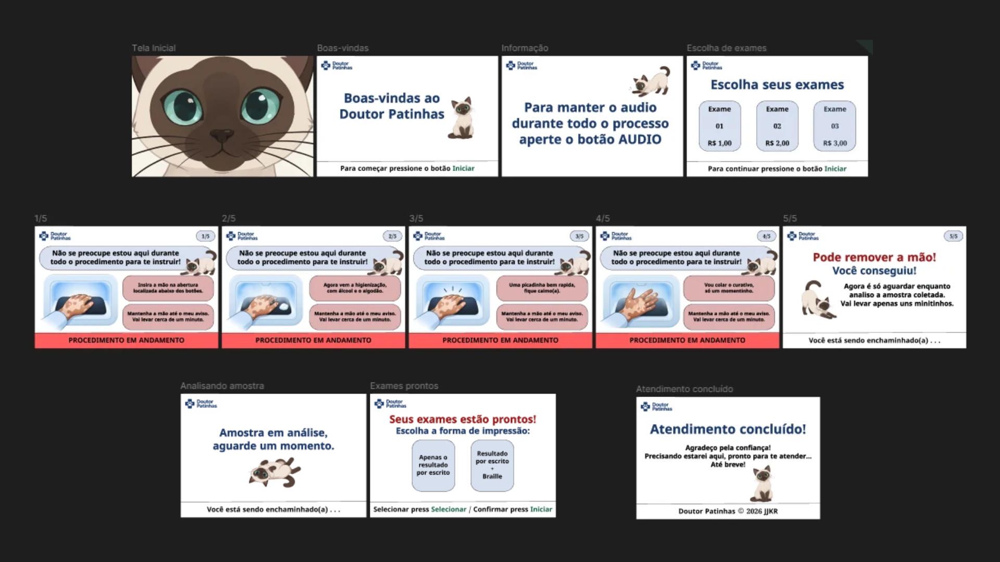

# 🩸 Projeto Doutor Patinhas

Protótipo de uma **máquina de coleta de sangue** desenvolvida na disciplina de **Interação Humano Computador**, pensada para ser instalada em **farmácias**, permitindo que os clientes realizem a coleta de forma autônoma, **sem a necessidade de um farmacêutico** acompanhando o procedimento.

## 👥 Integrantes do grupo

- Jaquelline Feitoza
- Juliana Saunders
- Kauã Oliveira
- Reinaldo Gomes

## 🎯 Objetivo

Criar um protótipo físico e de interface (software embarcado) de um equipamento de autoatendimento para coleta de sangue, priorizando a **usabilidade**, a **acessibilidade** e o conforto do usuário, de modo que a pessoa se sinta tranquila ao realizar o exame mesmo sem suporte presencial.

## 🖼️ Conceito do produto (gerado por IA)

Imagem conceitual da máquina, gerada com ferramentas de IA, demonstrando o produto desenvolvido:

## 🧰 Materiais utilizados

O protótipo físico foi construído com materiais de baixo custo disponíveis em casa:

- Caixa de papelão
- Cola
- Tampinhas
- Outros materiais recicláveis

### 📸 Protótipo inicial

## 📱 Prototipação das telas

As telas do software embarcado no equipamento foram elaboradas no **Figma**, contemplando os seguintes fluxos:

1. Seleção do(s) exame(s)
2. Procedimento de pagamento
3. Instruções sobre a coleta do material
4. Entrega do(s) resultado(s)
5. Informações intermediárias e complementares

🔗 **Protótipo no Figma:** [Doutor Patinhas](https://www.figma.com/design/GwLvPR7OUpES5NBINwQFMT/Doutor-Patinhas?node-id=0-1&p=f&t=1GZZfOV8Y4XhHdnV-0)

### 📱 Telas do software embarcado

## 🛠️ Etapas do projeto

1. Dar continuidade à prototipagem em papel (Paper Prototyping).
2. Registrar e enviar de 3 a 5 fotos do estado atual do protótipo.
3. Criar 2 imagens (utilizando ferramentas de IA) demonstrando o produto desenvolvido.
4. Elaborar o esboço de 10 a 15 telas do software embarcado no equipamento.
5. Relatar os desafios detectados durante o processo de prototipagem.

## ⚠️ Desafios identificados

- Pensar em todos os possíveis fluxos que o usuário pode percorrer e suas respectivas respostas.
- Fazer com que a pessoa fique tranquila ao fazer o exame, mesmo sem uma pessoa presente para dar suporte.
- Colocar todas as opções de pagamento possíveis, pensando também nas dificuldades de algumas pessoas.
- Encontrar uma forma alternativa de inclusão a todas as pessoas.

## 📂 Estrutura

- `README.md` — descrição do projeto.
- `prototipo-inicial.png` — foto do protótipo inicial.
- `ideia-maquina-ia.png` — imagem conceitual do produto (gerada por IA).
- `telas-doutor-patinhas.png` — telas do software embarcado (Figma).